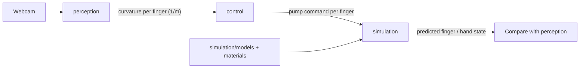

# Module contracts

The data each module passes to the next. These are descriptions for now, with no schemas or code. Update this file before changing what a module sends or expects.

Fingers are always named Thumb, Index, Middle, Ring, Pinky, matching `JOINTS` in [perception/main.py](perception/main.py).

## Perception → control

Produced inside [perception/main.py](perception/main.py) and drawn on the webcam frame, once per frame and per finger. Nothing exports this to another process yet.

| Field | Meaning |
| --- | --- |
| Curvature | Constant-curvature arc fitted to the finger's 4 landmarks (MCP to tip) by `finger_curvature()` in [perception/curvature_calculation.py](perception/curvature_calculation.py), 1/m. 0 is straight |
| Joint angle | Angle at the finger joint, degrees |
| Curl | `(180 - angle) / 90`, clipped to 0–1 |

**Control target:** each robot finger is driven to match the curvature that perception reports for the same hand finger. Mapping human curvature to the robot finger is a control setting. The default is a direct curvature match, and matching bend angle instead is an option, because the fingers differ in length. Control turns the target curvature into a chamber pressure using the finger's FEM pressure-to-shape map.

## Control → simulation (and hardware)

One command per finger, timestamped. Control runs on the PC beside perception. For now it sends commands straight to the simulator. How commands reach the microcontroller on the hand is not decided yet.

| Field | Meaning |
| --- | --- |
| `t_s` | Time, seconds |
| `duty` | PWM duty for that finger's pump, 0–1 |
| Valve state | Added once valves exist. v1 has none: the pumps are one-way, so each finger deflates through a fixed, tunable bleed |

## Simulation output

Inside simulation, a pump model turns PWM duty into chamber pressure (planned in `simulation/core/`). The finger model then gives the state below. The two stages are described in [simulation/README.md](simulation/README.md).

| Field | Stage 1 (one finger, FEM) | Stage 2 (whole hand) |
| --- | --- | --- |
| Chamber pressure, kPa | yes | yes, per finger |
| Bend angle, degrees | yes | yes, per finger |
| Tip position, mm | yes | yes |
| Curl 0–1 | yes, perception definition | yes |
| Joint angles, contact forces, object pose | — | yes |

Curl uses the same definition as perception, so simulated and tracked fingers can be compared. How that comparison is scored is still undecided.
