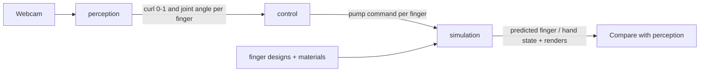

# Soft robotic hand

Control and simulation pipeline for a pneumatic soft robotic hand with cast Ecoflex PneuNet fingers driven by small air pumps.



| Module | Path | State |
| --- | --- | --- |
| Perception | [perception/](perception/) | Working webcam tracker (OpenCV + MediaPipe): angle and curl per finger |
| Control | [control/](control/) | Not implemented. Will map finger curls to pump commands |
| Simulation | [simulation/](simulation/) | Stage 1 (single-finger FEM in FEBio) working, first design results in. Stage 2 (whole hand in MuJoCo) not started |

The data passed between modules is described in [CONTRACTS.md](CONTRACTS.md).

## Repository layout

```
perception/          webcam hand tracker (main.py) and its original write-up
control/             perception -> pump commands (README only for now)
simulation/          finger and hand simulation, see simulation/README.md
  core/              shared loaders (materials, designs, local paths)
  materials/         material cards: Ecoflex, Dragon Skin, Elastosil, with sources and prices
  models/            finger designs: CAD (STEP) + design.toml, and a parametric generator
  stage1_finger/     single-finger FEM pipeline: mesh, FEBio, studies, analysis, renders
  stage2_hand/       whole-hand simulation (not started)
  docs/              experiment log with key images
  tests/             pytest suite for the simulation
requirements.txt     Python dependencies for all modules
CONTRACTS.md         the data each module passes to the next
```

## Setup

Windows, Python 3.11, from the repository root:

```bash
py -3.11 -m venv .venv
.venv\Scripts\activate
pip install -r requirements.txt
```

### Run the hand tracker

```bash
curl -L -o perception/hand_landmarker.task https://storage.googleapis.com/mediapipe-models/hand_landmarker/hand_landmarker/float16/1/hand_landmarker.task
python perception/main.py
```

Press `Q` to close the webcam window. The model file is not in git and must sit next to `perception/main.py`. The original write-up is [perception/README.md](perception/README.md); its commands assume the script is at the repository root, so use the ones above instead.

### Run the simulation

The simulation also needs the free FEBio solver, which is installed separately. Setup, running studies, and reproducing results are covered in [simulation/README.md](simulation/README.md). Results so far are in [simulation/docs/experiments.md](simulation/docs/experiments.md). The material card, fit and source behind each result are in its [Material profiles used](simulation/docs/experiments.md#material-profiles-used) section.

### Tests

```bash
.venv\Scripts\python -m pytest simulation/tests -q
```

Without FEBio installed, the one FEBio-dependent test is skipped.

## Git

Work happens on the branch `dev/hand-pipeline`. It merges into `main` through a pull request once simulation is ready. Generated simulation output, machine-specific paths, and local planning notes are gitignored.
