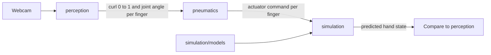

# Contracts

Data passed between modules. Descriptions only. No schemas and no code in this pass.

## Perception output

Produced today inside [perception/main.py](../perception/main.py) and drawn on the webcam frame. Fingers match `JOINTS`: Thumb, Index, Middle, Ring, Pinky.

| Field | Meaning |
| --- | --- |
| Joint angle | Angle at the finger joint, degrees |
| Curl | `(180 - angle) / 90`, clipped to 0–1 |

Nothing exports this to another process yet.

## Pneumatics command

One actuator command per finger. Units (pressure, valve duty, or a boolean) are undecided.

## Simulation state

The predicted hand after applying those commands to the model in [simulation/models/](../simulation/models/). How that state is compared with perception is undecided.
