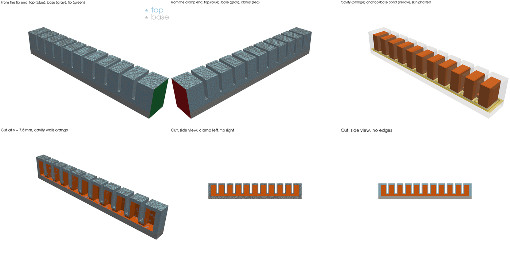
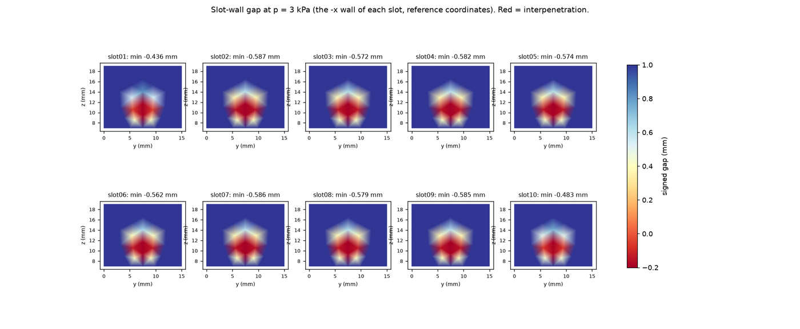
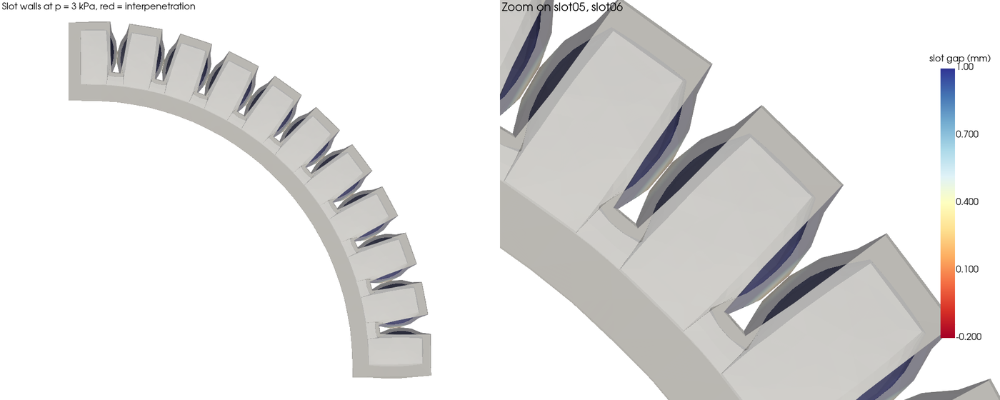
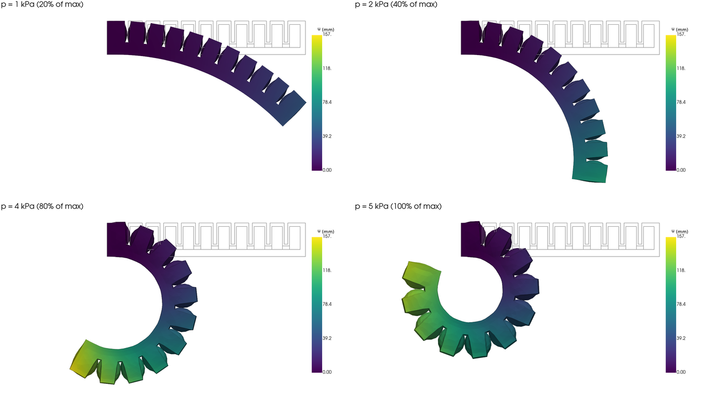
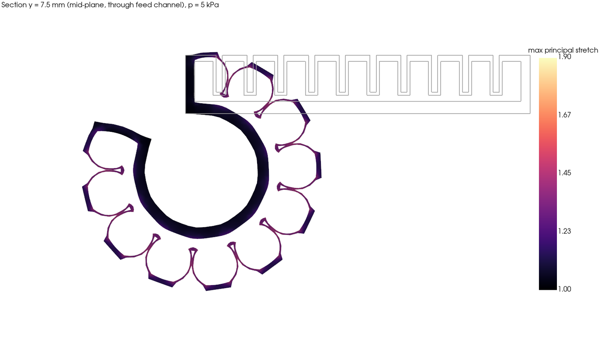
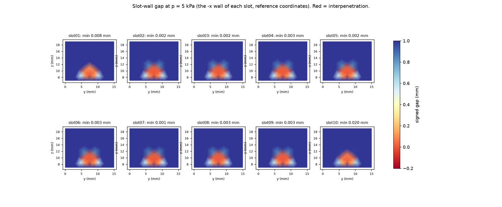
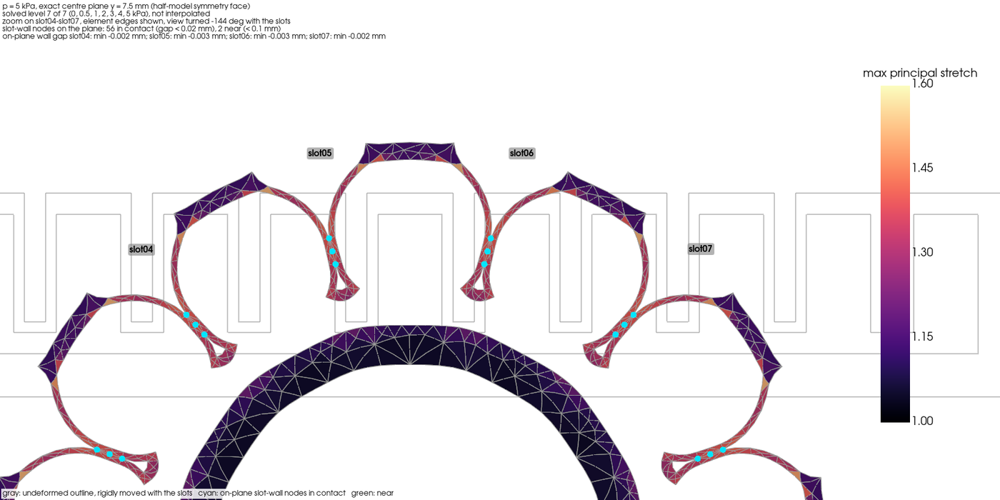
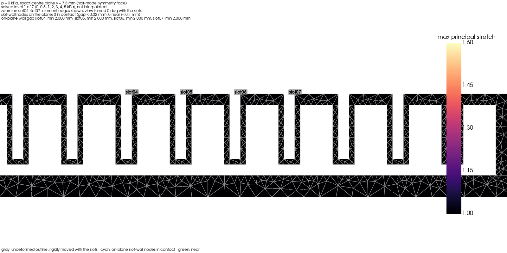
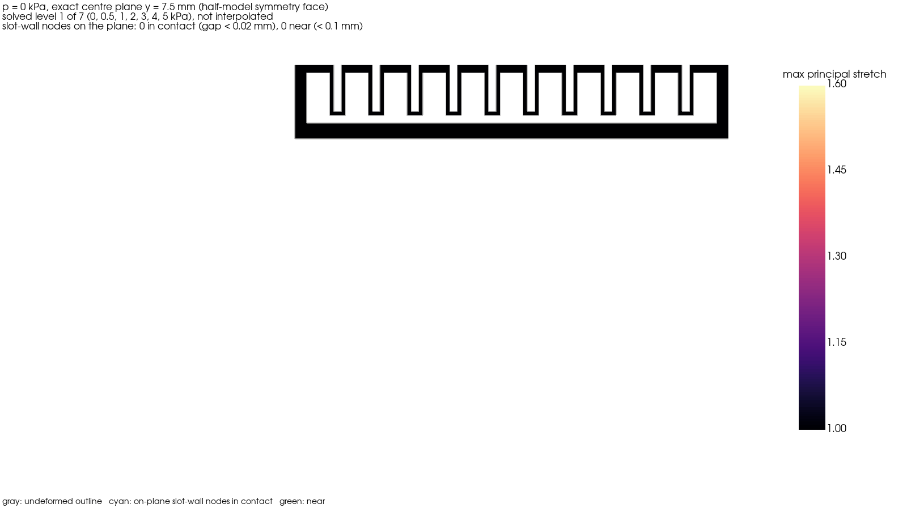
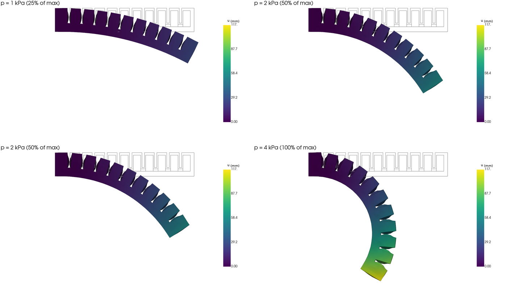

# Simulation experiment log

Results from the Stage 1 single-finger FEM pipeline, newest work last. Each entry says what was run, how to reproduce it, the key numbers, and what the renders showed. Every solved run was also checked visually, because metrics alone can hide problems such as walls passing through each other or inverted elements.

Run outputs (meshes, solver files, all renders) are written to `simulation/outputs/`, which is not in git. The images below are copies of the key renders. To reproduce a run, see [How to reproduce](#how-to-reproduce).

**Machine used:** AMD Ryzen AI 9 HX 370 (12 cores), 31 GB RAM, Windows 11, FEBio 4.13 (CPU only, Pardiso solver). Run times will differ on other machines.

---

## Summary so far

| # | Experiment | Result |
| --- | --- | --- |
| SW-0 | Install check: one element stretched in FEBio against the analytic solution | Matches to 0.06% |
| SW-1 | First pipeline solve (placeholder material) | Works. Showed that chamber walls touch, so contact is needed |
| SW-2 | Chamber-wall contact, on vs off | Without contact, walls overlap by 0.6 mm and the bend is 15% too low. Contact is now on by default |
| SW-3 | Solver tuning | About 3× faster, with answers unchanged to within 0.5% |
| SW-4 | Mesh convergence | Mesh "B" (3 mm global, 1 mm at walls) is within 1.5% of the finest mesh |
| SW-5 | **Ecoflex 00-30, 0–5 kPa** | **209° bend at 4 kPa, 287° at 5 kPa.** Peak stretch 1.81 |
| SW-7 (first look) | Ecoflex 00-50 vs 00-30 | 00-50 bends about 0.63× as much at the same pressure |

**Takeaways so far:**

- **Range of motion is easy to reach** with Ecoflex 00-30. The finger passes a 200° bend target at about 4 kPa, while the DS-370 pumps are listed at 10–60 kPa. Pressure needs limiting, or a stiffer grade.
- **Tip force is the likely problem.** At such low pressures, a hand estimate gives only about 0.05–0.1 N, against 0.4–1.5 N targets. This has not been simulated yet; it is the next experiment.
- **The thick, same-material base stretches 42% at 5 kPa,** so it is not acting as an inextensible layer.
- **Stiffness is uncertain.** Published Ecoflex 00-30 stiffness varies 2–4× by source (see [../materials/README.md](../materials/README.md)). A tensile test of our own cast silicone is the best way to narrow it.

---

## Model in brief

- **Geometry:** `finger_poc`, from the Onshape CAD in [../models/finger_poc/](../models/finger_poc/). It is 112 × 15 × 19 mm, with 11 chambers (6 × 11 × 13 mm inside) on a 10 mm pitch, 1 mm walls between chambers, 2 mm gaps between walls, and a 4 mm base. The top and base are cast separately, with the top's lip and pegs pressed into the wet base, so the cured finger is one piece. The model keeps them as two bonded parts, so each can get its own material.
- **Boundary conditions:** the proximal end (x = 0) is clamped. Pressure is applied to every internal cavity surface, rising slowly enough that each level is a static solution.
- **Material:** hyperelastic cards from [../materials/](../materials/). Ecoflex 00-30 uses the default Yeoh fit (Liao et al. 2020).
- **Mesh and contact:** quadratic tetrahedra, using the mirror symmetry of the finger (a half model), with frictionless contact between neighbouring chamber walls.



---

## SW-0 and SW-1: install check and first solve

- **SW-0.** A single quadratic tetrahedron stretched to 1.5× in FEBio matches the analytic neo-Hookean result to 0.06%. Its sideways shrinkage matches incompressibility (0.8167 vs 0.8165). This check is now a test: `simulation/tests/test_febio_uniaxial.py`.
  - **Found while doing it:** FEBio reports **zero reaction force** at nodes held with a "zero displacement" condition. The clamp and the blocked-force tip are therefore held with prescribed zero displacements, which do report forces.
- **SW-1.** Placeholder material (μ = 40 kPa), 0–2 kPa: the bend reached 51° at 2 kPa. The renders showed neighbouring chamber walls bulging toward each other and nearly touching, which led to SW-2.

## SW-2: chamber-wall contact

Contact is defined between the facing walls of all 10 gaps. After each solve, a check measures the gap between the paired walls and flags any overlap. Test case: placeholder material, 0.5–3 kPa.

| Pressure (kPa) | Bend, contact on (°) | Bend, contact off (°) | Min wall gap, on / off (mm) |
| --- | --- | --- | --- |
| 1.0 | 26.5 | 26.5 | both > 0 |
| 1.5 | 39.5 | 38.8 | walls first touch |
| 2.0 | 56.2 | 51.0 | |
| 3.0 | **88.5** | **75.6** | 0.003 / **−0.62** (overlap) |

Without contact, the walls pass through each other and the bend is about 15% too low. With contact, the walls press against each other and push the finger into more bend, which is how PneuNets work.

Contact off, at 3 kPa (red means the walls overlap):


Contact on, at 3 kPa. The walls meet over a patch with no overlap:


## SW-3: solver tuning

One change at a time, on a coarse test case. All of these kept the answer the same to 4 significant figures, except the half model (bend −0.2%, volume +0.5%).

| Setting | Wall time |
| --- | --- |
| First solve (BFGS, symmetric stiffness, 4 substeps) | 507 s |
| Full Newton iterations | 325 s |
| + 2 substeps and more aggressive time stepping | 258 s |
| + half model (mirror symmetry) | about 170 s |

- **Contact requires non-symmetric stiffness.** With the symmetric setting, the contact run stalls at 2.35 kPa.
- **No further gains** from fewer integration points or from changing the thread count. FEBio has no GPU support.
- All of these settings are now the defaults; the full table is in [../stage1_finger/README.md](../stage1_finger/README.md).
- **Time estimates:** `--estimate` runs the first pressure level and extrapolates the total time. So far, actual times have come in at 0.9–1.3× the low estimate. Past first wall contact, though, each kPa gets more expensive (see SW-5).

## SW-4: mesh convergence

Ecoflex 00-30, half model, contact on:

| Mesh | Global / wall element size (mm) | Nodes (half model) | Bend at 1 kPa | Error vs finest |
| --- | --- | --- | --- | --- |
| A | 4 / 1.5 | 25.9k | 41.5° | −7.8% |
| **B** | **3 / 1.0** | **48.0k** | **44.5°** | **−1.2%** |
| C | 2.5 / 0.8 | 68.5k | 45.1° | reference |

- **Mesh B is used for results.** Mesh A is fine for quick relative comparisons only.
- **Rule of thumb:** the element size at the chamber walls must be no larger than the wall thickness. Thinner wall variants need finer meshes.
- **Still to verify:** convergence at high pressure, where the walls balloon. In the high-pressure views, the 1 mm walls are only 1–2 elements thick.

## SW-5: Ecoflex 00-30 free bending, 0–5 kPa

Run with: `studies/eco30_sweep_10kPa.toml` (mesh B, half model, contact on). It was set to 10 kPa but stopped at its 70-minute time limit just past 5 kPa. Every level up to 5 kPa converged.

| Pressure (kPa) | Bend (°) | Cavity volume increase | Peak stretch, top / base |
| --- | --- | --- | --- |
| 0.5 | 22 | +12% | 1.09 / 1.03 |
| 1 | 45 | +20% | 1.16 / 1.07 |
| 2 | 97 | +37% | 1.30 / 1.14 |
| 3 | 150 | +57% | 1.45 / 1.22 |
| 4 | **209** | +85% | 1.61 / 1.30 |
| 5 | **287** | +130% | **1.81** / 1.42 |



Cross-section through the middle of the finger at 5 kPa, coloured by stretch. The chambers balloon into rounded lobes:


**Where the walls touch.** Contact is not over the whole wall. Each 1 mm wall bulges most at its centre, so neighbouring walls meet bulge to bulge. Meanwhile, bending stretches the top of the finger and pulls the gaps open there. The result is a contact patch about 4–5 mm wide, centred on the finger's midline and low on the wall (z ≈ 8–12 mm). It grows from 0.8% of the wall area at 1 kPa to about 6% at 5 kPa. The rest of each wall stays open, by up to a few mm. Even this small patch adds about 15% bend (SW-2).

Wall-gap map at 5 kPa. Orange is the contact patch, blue is open:


**On the exact centre plane** (y = 7.5 mm, the model's symmetry face, so no slicing artefacts), the walls of every gap meet in an hourglass pinch just above the gap's root, at z ≈ 9–11 mm. A small air pocket stays open below the pinch, and the gap opens into a V above it as the chambers balloon. The pinch first touches at 1 kPa and covers about 2 mm of wall height by 4–5 kPa. Cyan dots mark wall nodes in contact; the deepest overlap is 0.003 mm. Only 1–3 mesh nodes per gap resolve the pinch, so its length is approximate. 3.5 mm off the midline, the walls stay about 0.9 mm apart at every pressure, which is the edge of the patch.

Centre plane at 5 kPa, zoomed on gaps 4–7 (the view turns with the finger):


Animations over the solved levels 0, 0.5, 1, 2, 3, 4, 5 kPa (not interpolated):

| Zoom on gaps 4–7 | Whole finger |
| --- | --- |
|  |  |

To regenerate these, run `python -m simulation.stage1_finger.render <run folder> --center-sections`.

Findings:

- **The 200° bend target is reached at about 4 kPa.** Past about 6 kPa, the tip would run into the base (the model does not handle that contact), and the chambers keep ballooning.
- **Peak stretch** of 1.81 (81% strain) at 5 kPa is well below Ecoflex 00-30's 900% elongation at break.
- **The base stretches 42%.** Making the base stiffer or thinner would put more of the chamber work into bending. Both are queued as experiments.
- **The pressure needed for a given bend depends on the true stiffness of our silicone,** which is uncertain by 2–4×.
- **Run time:** this run took 70 minutes. Each kPa past first wall contact costs about 10–12 minutes on mesh B.

## SW-7 (first look): Ecoflex 00-50 vs 00-30

A quick run on the coarse mesh A, so compare ratios, not absolute values (`studies/dev/eco50_quick_meshA.toml`).

| Pressure (kPa) | 00-50 bend (°) | 00-30 bend (°), same mesh | Ratio |
| --- | --- | --- | --- |
| 1 | 26.9 | 41.5 | 0.65 |
| 2 | 56.6 | 92.5 | 0.61 |
| 4 | 121.5 | — | — |

- **Consistency check:** the ratio matches the two materials' stiffness ratio (25.2 / 39.1 kPa = 0.64).
- **Implication:** 00-50 needs about 1.6× the pressure for the same bend, roughly 6–7 kPa for 200° (extrapolated). That should give proportionally more tip force.
- Both grades below the 200° range bend smoothly:



---

## Next experiments

1. **Blocked tip force** for Ecoflex 00-30 at 1–5 kPa. This tests the main open risk.
2. **Grade sweep:** Ecoflex 00-50 on mesh B, then Dragon Skin 10/20/30.
3. **Base material:** Dragon Skin base under an Ecoflex top.
4. **Thickness variants:** base 2, 3, and 6 mm; chamber walls 0.75 and 1.5 mm. Generated with `python -m simulation.models.tools.make_pneunet --standard-variants`.
5. **High-pressure mesh check:** for ballooning walls, and for the thin-wall variants.

---

## How to reproduce

Set up the environment and FEBio as described in [../README.md](../README.md). Then, from the repository root:

```bash
# Estimate run time first (meshes, then solves the first pressure level only)
.venv\Scripts\python -m simulation.stage1_finger.run simulation/stage1_finger/studies/eco30_sweep_10kPa.toml --estimate

# Full run, with a hard timeout in seconds
.venv\Scripts\python -m simulation.stage1_finger.run simulation/stage1_finger/studies/eco30_sweep_10kPa.toml --timeout-s 4200

# Redraw the renders of an existing run without re-solving
.venv\Scripts\python -m simulation.stage1_finger.render simulation/outputs/eco30_sweep_10kPa/<run folder>
```

| Experiment | Study file | Approx. time on the machine above |
| --- | --- | --- |
| SW-1 | `studies/poc_smoke.toml` | 4–9 min |
| SW-2 | `studies/poc_contact_check.toml`, `studies/dev/poc_contact_off.toml` | about 6 min each |
| SW-3 | `studies/dev/tune_*.toml` | 4–9 min each |
| SW-4 | `studies/dev/tune_mesh_A/B/C.toml` | 9 / 15 / 11 min |
| SW-5 | `studies/eco30_sweep_10kPa.toml` | 70 min to 5 kPa |
| SW-7 | `studies/dev/eco50_quick_meshA.toml` | 11 min |

Each run writes `simulation/outputs/<study>/<UTC timestamp>/`, containing `results.json` (per-pressure metrics), `plots/`, and `renders/`. Look at the renders after every run.
