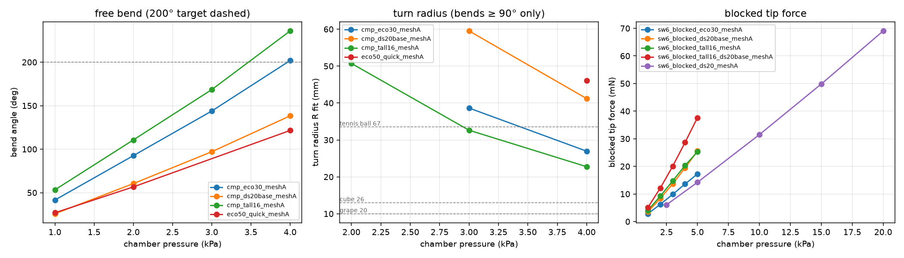
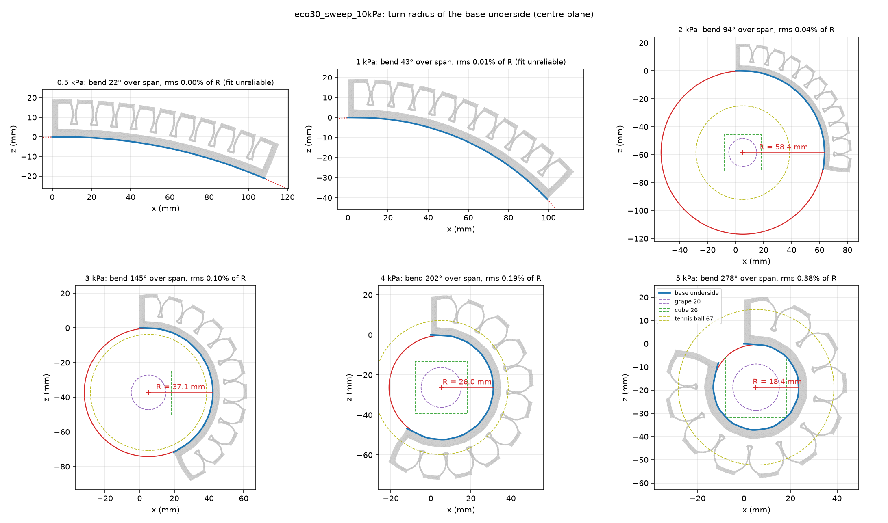
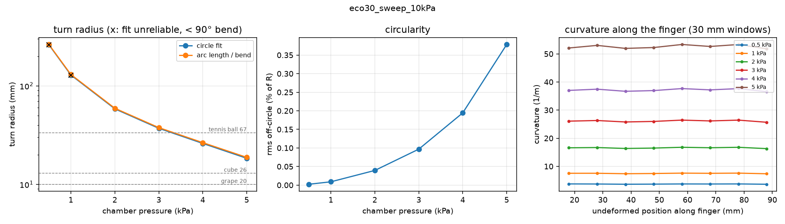
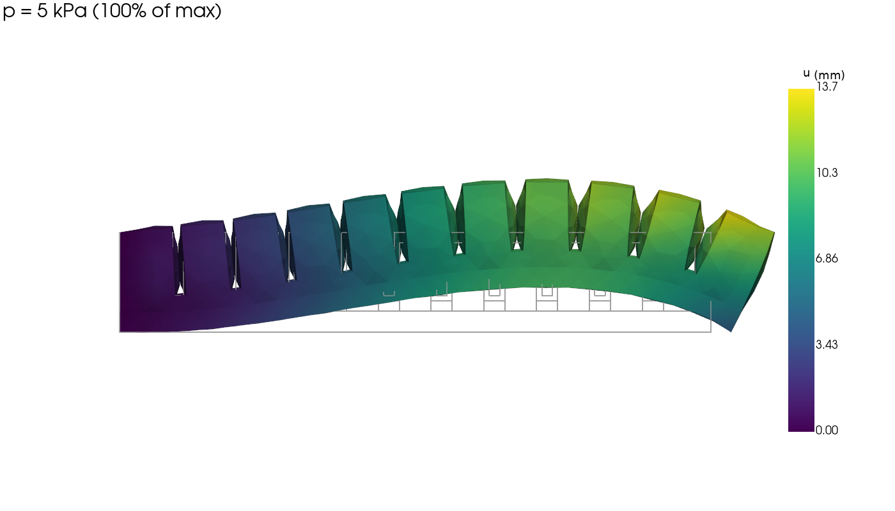
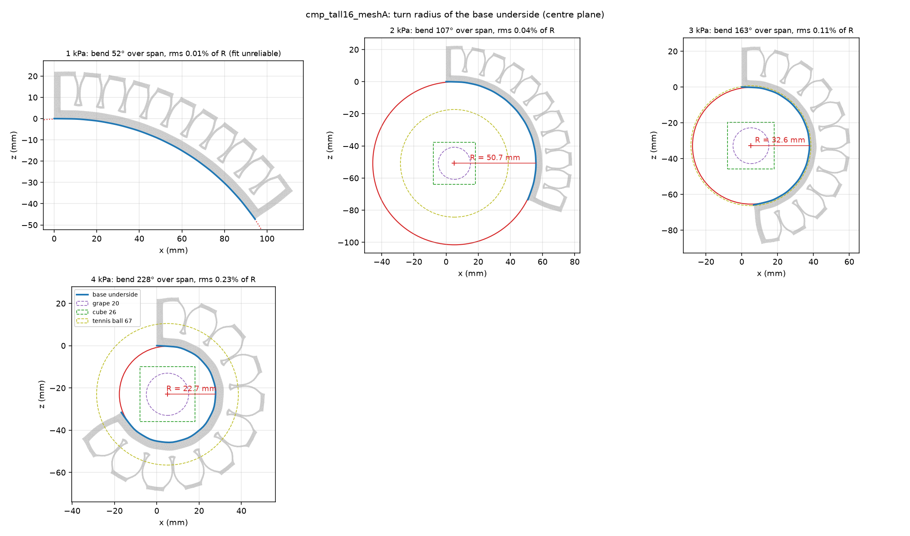
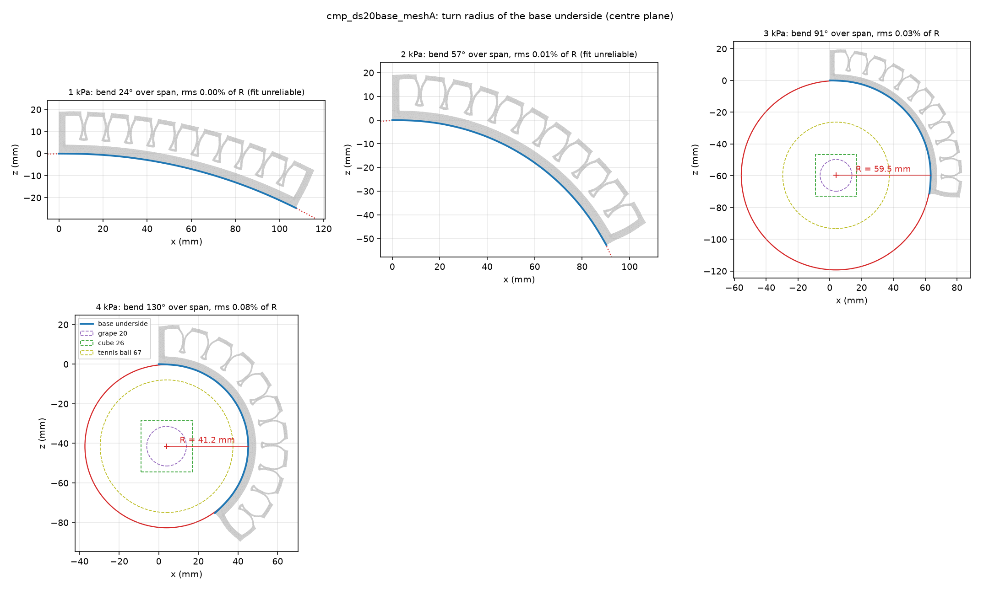

# Simulation experiment log

Results from the Stage 1 single-finger FEM pipeline, newest work last. Each entry says what was run, how to reproduce it, the key numbers, and what the renders showed. Every solved run was also checked visually, because metrics alone can hide problems such as walls passing through each other or inverted elements.

Run outputs (meshes, solver files, all renders) are written to `simulation/outputs/`, which is not in git. The images below are copies of the key renders. To reproduce a run, see [How to reproduce](#how-to-reproduce).

**Machine used:** AMD Ryzen AI 9 HX 370 (12 cores), 31 GB RAM, Windows 11, FEBio 4.13 (CPU only, Pardiso solver). Run times will differ on other machines.

---

## Summary so far

| # | Experiment | Result |
| --- | --- | --- |
| SW-0 | Install check: one element stretched in FEBio against the analytic solution | Matches to 0.06% |
| SW-1 | First pipeline solve (placeholder material) | Works. Showed that chamber walls touch, so contact is needed |
| SW-2 | Chamber-wall contact, on vs off | Without contact, walls overlap by 0.6 mm and the bend is 15% too low. Contact is now on by default |
| SW-3 | Solver tuning | About 3× faster, with answers unchanged to within 0.5% |
| SW-4 | Mesh convergence | Mesh "B" (3 mm global, 1 mm at walls) is within 1.5% of the finest mesh |
| SW-5 | **Ecoflex 00-30, 0–5 kPa** | **209° bend at 4 kPa, 287° at 5 kPa.** Peak stretch 1.81 |
| SW-6 | **Blocked tip force** | Ecoflex 00-30: **0.017 N at 5 kPa,** 25–90× below target. Tall chambers plus a Dragon Skin 20 base: 2.2×. Stiffer silicone: force rises with stiffness at matching pressure |
| SW-7 (first look) | Ecoflex 00-50 vs 00-30 | 00-50 bends about 0.63× as much at the same pressure |
| Turn radius | New metric: circle fit to the base underside | R = 26 mm at 4 kPa, 18 mm at 5 kPa; circular to within 0.4% |
| Design comparison | Dragon Skin 20 base; 16 mm tall chambers (mesh A) | **Tall chambers: +17% bend and +46% force.** A Dragon Skin 20 base: 0.68× bend, 1.48× force |

**Takeaways so far:**

- **Range of motion is easy to reach** with Ecoflex 00-30. The finger passes a 200° bend target at about 4 kPa, while the DS-370 pumps are listed at 10–60 kPa. Pressure needs limiting, or a stiffer grade.
- **Tip force is the problem.** The blocked tip force is only 0.017 N at 5 kPa (SW-6), 25–90× below the 0.4–1.5 N targets.
- **The base curls into an almost perfect circle:** R = 26 mm at 4 kPa and 18 mm at 5 kPa, so the finger can wrap a tennis-ball-sized object from about 3.3 kPa ([turn radius](#turn-radius-how-tightly-the-finger-curls)).
- **The thick, same-material base stretches 42% at 5 kPa,** so it is not acting as an inextensible layer. A Dragon Skin 20 base cuts that to 8%, with 1.5× the force but two-thirds of the bend.
- **Taller chambers are the clear geometry win:** 16 mm instead of 13 mm gives more bend and more force at the same pressure.
- **Stiffness is uncertain.** Published Ecoflex 00-30 stiffness varies 2–4× by source (see [../materials/README.md](../materials/README.md)). A tensile test of our own cast silicone is the best way to narrow it.

---

## Material profiles used

Every reported result used one of the four profiles below. The coefficients are copied from the card. The initial shear modulus is mu0 from `Fit.initial_shear_modulus_kPa()` in [../core/materials.py](../core/materials.py): Yeoh 2 C10, Ogden sum of mu_i, neo-Hookean mu. The bulk modulus K is what each run's `metadata.json` records for FEBio. For the three real fits it is the study's `bulk_to_shear` = 100 times mu0. For the placeholder it comes from the card's Poisson ratio. All solved runs used fit 0 of their card. A run's `metadata.json` lists the exact fit of each part (`materials.top` and `materials.base`).

| Card | Fit | Model | Coefficients (from the card) | mu0 (kPa) | Bulk modulus K | Source | Used in |
| --- | --- | --- | --- | --- | --- | --- | --- |
| [ecoflex_00-30](../materials/ecoflex_00-30.toml) | 0 | Yeoh | C10 = 12.58 kPa, C20 = 0.5759 kPa, C30 = 0.0 kPa | 25.2 | 2.516 MPa (100 x mu0) | Liao, Hossain, Yao 2020, Mechanics of Materials 144:103366, Table 2 (accepted pre-proof). DOI 10.1016/j.mechmat.2020.103366. Confidence medium | SW-4, SW-5, SW-6, Turn radius, Design comparison (top and base of the Ecoflex 00-30 baseline and the 16 mm tall variant; top of the Dragon Skin 20 base variants), SW-7 baseline |
| [ecoflex_00-50](../materials/ecoflex_00-50.toml) | 0 | Yeoh | C10 = 19.54 kPa, C20 = 1.137 kPa, C30 = 0.0 kPa | 39.1 | 3.908 MPa (100 x mu0) | Liao, Hossain, Yao 2020, Mechanics of Materials 144:103366, Table 2 (accepted pre-proof). DOI 10.1016/j.mechmat.2020.103366. Confidence medium | SW-7, Design comparison (Ecoflex 00-50 throughout; `eco50_quick_meshA`) |
| [dragon_skin_20](../materials/dragon_skin_20.toml) | 0 | Ogden, 1 term | mu1 = 125.0 kPa, alpha1 = 2.94 | 125 | 12.5 MPa (100 x mu0) | Fit by this library (2026-10-19) to the raw data of Marechal et al. 2021 (Zenodo 10.5281/zenodo.3611328, `Dragon Skin 20.csv`; paper DOI 10.1089/soro.2019.0115). Not a published coefficient set. Confidence medium | SW-6 and Design comparison (Dragon Skin 20 base, tall chambers plus Dragon Skin 20 base, Dragon Skin 20 throughout) |
| [_placeholder_neo_hookean](../materials/_placeholder_neo_hookean.toml) | 0 | neo-Hookean | mu = 40.0 kPa, Poisson ratio 0.49 | 40.0 | 1.987 MPa (from Poisson ratio 0.49) | None. A placeholder of Ecoflex-like order of magnitude, for pipeline checks only. Confidence low | SW-1, SW-2, SW-3 |

The placeholder is not a silicone fit. Its results show that the pipeline works. They are not material predictions.

Fits that were not used in any reported result: fit 1 and fit 2 of every card, and all other cards. Stiffness across fits is compared in [../materials/README.md](../materials/README.md).

---

## All results in one place

Every design-relevant run, per pressure level. Mesh B is the accurate mesh; mesh A reads a few % stiff, so compare mesh A rows with the mesh A baseline. Column definitions are in [Turn radius](#turn-radius-how-tightly-the-finger-curls) and [SW-6](#sw-6-blocked-tip-force-first-result). To regenerate the full table for every run, including dev and tuning runs, run `python -m simulation.stage1_finger.summarize`. It writes `simulation/outputs/summary.md` and `summary.csv`.

**Free bending:**

| Variant | Mesh | p (kPa) | Bend (°) | R fit (mm) | Circularity (% of R) | Underside length | Cavity volume | Peak stretch, top / base |
| --- | --- | --- | --- | --- | --- | --- | --- | --- |
| Ecoflex 00-30 (reference) | B | 0.5 | 22 | — | — | 0.993 | +12% | 1.09 / 1.03 |
|  |  | 1 | 45 | — | — | 0.986 | +20% | 1.16 / 1.07 |
|  |  | 2 | 97 | 58.4 | 0.04 | 0.969 | +37% | 1.30 / 1.14 |
|  |  | 3 | 150 | 37.1 | 0.10 | 0.952 | +57% | 1.45 / 1.22 |
|  |  | 4 | 209 | 26.0 | 0.19 | 0.934 | +85% | 1.61 / 1.30 |
|  |  | 5 | 287 | 18.4 | 0.38 | 0.910 | +130% | 1.81 / 1.42 |
| Ecoflex 00-30 (baseline) | A | 1 | 42 | — | — | 0.987 | +20% | 1.14 / 1.04 |
|  |  | 2 | 93 | — | — | 0.971 | +36% | 1.25 / 1.10 |
|  |  | 3 | 144 | 38.6 | 0.09 | 0.955 | +55% | 1.36 / 1.16 |
|  |  | 4 | 202 | 27.0 | 0.18 | 0.936 | +81% | 1.48 / 1.25 |
| Dragon Skin 20 base | A | 1 | 26 | — | — | 0.993 | +18% | 1.14 / 1.02 |
|  |  | 2 | 60 | — | — | 0.982 | +32% | 1.24 / 1.03 |
|  |  | 3 | 97 | 59.5 | 0.03 | 0.972 | +49% | 1.34 / 1.05 |
|  |  | 4 | 138 | 41.2 | 0.08 | 0.959 | +71% | 1.46 / 1.08 |
| 16 mm tall chambers | A | 1 | 53 | — | — | 0.982 | +23% | 1.15 / 1.05 |
|  |  | 2 | 111 | 50.7 | 0.04 | 0.963 | +42% | 1.27 / 1.11 |
|  |  | 3 | 168 | 32.6 | 0.11 | 0.945 | +65% | 1.40 / 1.19 |
|  |  | 4 | 236 | 22.7 | 0.23 | 0.923 | +99% | 1.56 / 1.29 |
| Ecoflex 00-50 throughout | A | 1 | 27 | — | — | 0.992 | +14% | 1.10 / 1.03 |
|  |  | 2 | 57 | — | — | 0.982 | +24% | 1.17 / 1.06 |
|  |  | 4 | 122 | 46.1 | 0.06 | 0.962 | +46% | 1.31 / 1.13 |

**Blocked tip force (mN), tip held in z:**

| Variant (mesh A) | 1 kPa | 2 kPa | 2.5 kPa | 3 kPa | 4 kPa | 5 kPa | 10 kPa | 15 kPa | 20 kPa |
| --- | --- | --- | --- | --- | --- | --- | --- | --- | --- |
| Ecoflex 00-30 (baseline) | 2.8 | 6.3 |  | 9.9 | 13.6 | 17.3 |  |  |  |
| Dragon Skin 20 base | 3.5 | 8.4 |  | 13.7 | 19.5 | 25.6 |  |  |  |
| 16 mm tall chambers | 4.1 | 9.2 |  | 14.8 | 20.3 | 25.3 |  |  |  |
| Tall chambers + Dragon Skin 20 base | 5.1 | 12.2 |  | 20.1 | 28.7 | 37.6 |  |  |  |
| Dragon Skin 20 throughout |  |  | 6.1 |  |  | 14.2 | 31.5 | 49.8 | 69.0 |



---

## Model in brief

- **Geometry:** `finger_poc`, from the Onshape CAD in [../models/finger_poc/](../models/finger_poc/). It is 112 × 15 × 19 mm, with 11 chambers (6 × 11 × 13 mm inside) on a 10 mm pitch, 1 mm walls between chambers, 2 mm gaps between walls, and a 4 mm base. The top and base are cast separately, with the top's lip and pegs pressed into the wet base, so the cured finger is one piece. The model keeps them as two bonded parts, so each can get its own material.
- **Boundary conditions:** the proximal end (x = 0) is clamped. Pressure is applied to every internal cavity surface, rising slowly enough that each level is a static solution.
- **Material:** hyperelastic cards from [../materials/](../materials/). Ecoflex 00-30 uses the default Yeoh fit (fit 0, Liao et al. 2020). Every profile used is listed in [Material profiles used](#material-profiles-used).
- **Mesh and contact:** quadratic tetrahedra, using the mirror symmetry of the finger (a half model), with frictionless contact between neighbouring chamber walls.


---

## SW-0 and SW-1: install check and first solve

- **SW-0.** A single quadratic tetrahedron stretched to 1.5× in FEBio matches the analytic neo-Hookean result to 0.06%. Its sideways shrinkage matches incompressibility (0.8167 vs 0.8165). This check is now a test: `simulation/tests/test_febio_uniaxial.py`.
  - **Found while doing it:** FEBio reports **zero reaction force** at nodes held with a "zero displacement" condition. The clamp and the blocked-force tip are therefore held with prescribed zero displacements, which do report forces.
  - **Reaction sign (checked later, in SW-6):** FEBio logs the force the body exerts on the support. The test asserts this.
- **SW-1.** Placeholder neo-Hookean material (μ = 40 kPa, not a silicone fit; see [Material profiles used](#material-profiles-used)), 0–2 kPa: the bend reached 51° at 2 kPa. The renders showed neighbouring chamber walls bulging toward each other and nearly touching, which led to SW-2.

## SW-2: chamber-wall contact

Material: placeholder neo-Hookean, mu = 40 kPa (a placeholder, not a silicone fit), see [Material profiles used](#material-profiles-used).

Contact is defined between the facing walls of all 10 gaps. After each solve, a check measures the gap between the paired walls and flags any overlap. Test case: placeholder material, 0.5–3 kPa.

| Pressure (kPa) | Bend, contact on (°) | Bend, contact off (°) | Min wall gap, on / off (mm) |
| --- | --- | --- | --- |
| 1.0 | 26.5 | 26.5 | both > 0 |
| 1.5 | 39.5 | 38.8 | walls first touch |
| 2.0 | 56.2 | 51.0 | |
| 3.0 | **88.5** | **75.6** | 0.003 / **−0.62** (overlap) |

Without contact, the walls pass through each other and the bend is about 15% too low. With contact, the walls press against each other and push the finger into more bend, which is how PneuNets work.

Contact off, at 3 kPa (red means the walls overlap):


Contact on, at 3 kPa. The walls meet over a patch with no overlap:


## SW-3: solver tuning

Material: placeholder neo-Hookean, mu = 40 kPa (a placeholder, not a silicone fit), see [Material profiles used](#material-profiles-used).

One change at a time, on a coarse test case. All of these kept the answer the same to 4 significant figures, except the half model (bend −0.2%, volume +0.5%).

| Setting | Wall time |
| --- | --- |
| First solve (BFGS, symmetric stiffness, 4 substeps) | 507 s |
| Full Newton iterations | 325 s |
| + 2 substeps and more aggressive time stepping | 258 s |
| + half model (mirror symmetry) | about 170 s |

- **Contact requires non-symmetric stiffness.** With the symmetric setting, the contact run stalls at 2.35 kPa.
- **No further gains** from fewer integration points or from changing the thread count. FEBio has no GPU support.
- All of these settings are now the defaults; the full table is in [../stage1_finger/README.md](../stage1_finger/README.md).
- **Time estimates:** `--estimate` runs the first pressure level and extrapolates the total time. So far, actual times have come in at 0.9–1.3× the low estimate. Past first wall contact, though, each kPa gets more expensive (see SW-5).

## SW-4: mesh convergence

Material: Ecoflex 00-30, fit 0 (Yeoh, Liao et al. 2020), see [Material profiles used](#material-profiles-used).

Ecoflex 00-30, half model, contact on:

| Mesh | Global / wall element size (mm) | Nodes (half model) | Bend at 1 kPa | Error vs finest |
| --- | --- | --- | --- | --- |
| A | 4 / 1.5 | 25.9k | 41.5° | −7.8% |
| **B** | **3 / 1.0** | **48.0k** | **44.5°** | **−1.2%** |
| C | 2.5 / 0.8 | 68.5k | 45.1° | reference |

- **Mesh B is used for results.** Mesh A is fine for quick relative comparisons only.
- **Rule of thumb:** the element size at the chamber walls must be no larger than the wall thickness. Thinner wall variants need finer meshes.
- **Still to verify:** convergence at high pressure, where the walls balloon. In the high-pressure views, the 1 mm walls are only 1–2 elements thick.

## SW-5: Ecoflex 00-30 free bending, 0–5 kPa

Material: Ecoflex 00-30, fit 0 (Yeoh, Liao et al. 2020), see [Material profiles used](#material-profiles-used).

Run with: `studies/eco30_sweep_10kPa.toml` (mesh B, half model, contact on). It was set to 10 kPa but stopped at its 70-minute time limit just past 5 kPa. Every level up to 5 kPa converged.

| Pressure (kPa) | Bend (°) | Cavity volume increase | Peak stretch, top / base |
| --- | --- | --- | --- |
| 0.5 | 22 | +12% | 1.09 / 1.03 |
| 1 | 45 | +20% | 1.16 / 1.07 |
| 2 | 97 | +37% | 1.30 / 1.14 |
| 3 | 150 | +57% | 1.45 / 1.22 |
| 4 | **209** | +85% | 1.61 / 1.30 |
| 5 | **287** | +130% | **1.81** / 1.42 |


Cross-section through the middle of the finger at 5 kPa, coloured by stretch. The chambers balloon into rounded lobes:


**Where the walls touch.** Contact is not over the whole wall. Each 1 mm wall bulges most at its centre, so neighbouring walls meet bulge to bulge. Meanwhile, bending stretches the top of the finger and pulls the gaps open there. The result is a contact patch about 4–5 mm wide, centred on the finger's midline and low on the wall (z ≈ 8–12 mm). It grows from 0.8% of the wall area at 1 kPa to about 6% at 5 kPa. The rest of each wall stays open, by up to a few mm. Even this small patch adds about 15% bend (SW-2).

Wall-gap map at 5 kPa. Orange is the contact patch, blue is open:


**On the exact centre plane** (y = 7.5 mm, the model's symmetry face, so no slicing artefacts), the walls of every gap meet in an hourglass pinch just above the gap's root, at z ≈ 9–11 mm. A small air pocket stays open below the pinch, and the gap opens into a V above it as the chambers balloon. The pinch first touches at 1 kPa and covers about 2 mm of wall height by 4–5 kPa. Cyan dots mark wall nodes in contact; the deepest overlap is 0.003 mm. Only 1–3 mesh nodes per gap resolve the pinch, so its length is approximate. 3.5 mm off the midline, the walls stay about 0.9 mm apart at every pressure, which is the edge of the patch.

Centre plane at 5 kPa, zoomed on gaps 4–7 (the view turns with the finger):


Animations over the solved levels 0, 0.5, 1, 2, 3, 4, 5 kPa (not interpolated):

| Zoom on gaps 4–7 | Whole finger |
| --- | --- |
|  |  |

To regenerate these, run `python -m simulation.stage1_finger.render <run folder> --center-sections`.

Findings:

- **The 200° bend target is reached at about 4 kPa.** Past about 6 kPa, the tip would run into the base (the model does not handle that contact), and the chambers keep ballooning.
- **Peak stretch** of 1.81 (81% strain) at 5 kPa is well below Ecoflex 00-30's 900% elongation at break.
- **The base stretches 42%.** Making the base stiffer or thinner would put more of the chamber work into bending. Both are queued as experiments.
- **The pressure needed for a given bend depends on the true stiffness of our silicone,** which is uncertain by 2–4×.
- **Run time:** this run took 70 minutes. Each kPa past first wall contact costs about 10–12 minutes on mesh B.

## SW-7 (first look): Ecoflex 00-50 vs 00-30

Material: Ecoflex 00-50, fit 0 (Yeoh, Liao et al. 2020), against Ecoflex 00-30, fit 0 (Yeoh, Liao et al. 2020), see [Material profiles used](#material-profiles-used).

A quick run on the coarse mesh A, so compare ratios, not absolute values (`studies/dev/eco50_quick_meshA.toml`).

| Pressure (kPa) | 00-50 bend (°) | 00-30 bend (°), same mesh | Ratio |
| --- | --- | --- | --- |
| 1 | 26.9 | 41.5 | 0.65 |
| 2 | 56.6 | 92.5 | 0.61 |
| 4 | 121.5 | — | — |

- **Consistency check:** the ratio matches the two materials' stiffness ratio (25.2 / 39.1 kPa = 0.64).
- **Implication:** 00-50 needs about 1.6× the pressure for the same bend, roughly 6–7 kPa for 200° (extrapolated). That should give proportionally more tip force.
- Both grades below the 200° range bend smoothly:


## Turn radius: how tightly the finger curls

Material (from the SW-5 run): Ecoflex 00-30, fit 0 (Yeoh, Liao et al. 2020), see [Material profiles used](#material-profiles-used).

At higher pressures the base curls into a rough circle. The turn radius measures that circle on the surface that touches objects: the base underside, along the finger's centreline (the half model's symmetry face). Only the chambered length (x = 3–109 mm) is used, so the solid end walls don't distort it. Code: [../stage1_finger/analysis/curvature.py](../stage1_finger/analysis/curvature.py). Every free-bending run now reports it in `results.json` (`turn_radius`) and plots it to `plots/turn_radius*.png`.

- **R fit:** radius of the best-fit circle through the deformed underside.
- **Circularity:** how far the underside strays from that circle (RMS, as % of R). Small means it really is a circle.
- **R avg:** arc length / bend over the same span, the mean radius. It matches the targets note's definition (200° ⇒ R ≤ 34 mm).
- **Underside length:** deformed / original length of the underside. Below 1 means it is compressed, as the inside of a curl should be.
- **Below about 90° of bend** a circle fit is ill-conditioned, so only R avg is quoted there.

Check: a synthetic constant-curvature bend returns the exact radius with 0% residual (`simulation/tests/test_analysis.py`).

Ecoflex 00-30, `finger_poc`, mesh B (from the SW-5 run, no new solve):

| Pressure (kPa) | Bend (°) | R fit (mm) | R avg (mm) | Circularity (% of R) | Underside length |
| --- | --- | --- | --- | --- | --- |
| 0.5 | 22 | — | 264 | — | 0.99 |
| 1 | 45 | — | 131 | — | 0.99 |
| 2 | 97 | 58.4 | 59.3 | 0.04 | 0.97 |
| 3 | 150 | 37.1 | 37.7 | 0.10 | 0.95 |
| 4 | 209 | **26.0** | 26.5 | 0.19 | 0.93 |
| 5 | 287 | **18.4** | 18.8 | 0.38 | 0.91 |





Findings:

- **The underside is almost a perfect circle.** It stays within 0.4% of R of a circle even at 5 kPa, and curvature is uniform along the finger to within about 3%. No part of the finger bends more than another, which is what equal chambers on a uniform base should give.
- **What it can wrap:** R = 26 mm at 4 kPa and 18 mm at 5 kPa, against a tennis ball's 33.5 mm radius, a 26 mm cube (13 mm half-width) and a 20 mm grape (10 mm radius). The finger curls tightly enough to wrap a tennis ball from about 3.3 kPa. The grape and small cube are well inside its tightest curl, so they are tip-pinch objects.
- **The underside compresses** by 9% at 5 kPa. So the neutral surface, which keeps its length, sits inside the base, about 2 mm above the underside.
- **Average radius is mostly bend angle in mm** (R ≈ arc length / bend). The extra information is the circularity, the curvature profile, and radii that can be compared directly with object sizes.

## SW-6: blocked tip force (first result)

Material: Ecoflex 00-30, fit 0 (Yeoh, Liao et al. 2020) for the baseline. Variants add Dragon Skin 20, fit 0 (1-term Ogden, library refit of Marechal et al. 2021 data), as base or throughout, see [Material profiles used](#material-profiles-used).

`studies/compare/sw6_blocked_eco30_meshA.toml`: Ecoflex 00-30, mesh A (relative accuracy only, about 8% stiff), half model, contact on. The whole tip face is held in z (the bend direction) and is free to slide along the finger. The blocked force is the reaction on that face.

**Correction (2026-10-26):** this hold is not a free pin. Holding every tip-face node in z also resists rotation: the reactions carry a moment of 1.43 N·mm about the tip centroid at 5 kPa, against F × L ≈ 1.9 N·mm. The face still rotates (24° at 5 kPa), but against that moment. So the absolute forces below sit somewhere between a pinned and a clamped tip, and a true point contact (a fingertip on a load cell) may read higher. The **relative** comparisons between variants still hold, because every variant used the same hold. A point-contact run is queued (FEM-C1 in the real-time sim plan).

| Pressure (kPa) | Blocked tip force (N) | Tip-face rotation (°) | Cavity volume increase |
| --- | --- | --- | --- |
| 1 | 0.0028 | 8 | +18% |
| 2 | 0.0063 | 13 | +30% |
| 3 | 0.0099 | 17 | +44% |
| 4 | 0.0136 | 20 | +61% |
| 5 | **0.017** | 24 | +84% |

Held at the tip, the finger arches upward by about 8 mm mid-span instead of pressing harder. This is the expected shape for a clamped beam that "wants" to curl but is propped at its tip:



- **The force is very small:** about 3.5 mN per kPa, so 0.017 N at 5 kPa. That is 25–90× below the 0.4–1.5 N targets, and about 3× below the earlier hand estimate.
- **Sanity check:** the tip stiffness of a clamped beam (from the free-bending curvature and a rough bending stiffness of the slotted section) gives about 5 mN at 1 kPa, against 2.8 mN simulated. Same order.
- **Sign convention, found while checking this:** FEBio logs reaction forces as the force the body exerts on its support, not the force the support exerts on the body. The single-element test now asserts the sign, and the blocked force reads positive toward the palm.
### What raises the force

Same setup, one change at a time (`studies/compare/sw6_blocked_*.toml`, mesh A, about 3–5 min each):

| Variant | Force at 5 kPa (mN) | vs baseline | Force at the highest level |
| --- | --- | --- | --- |
| Baseline: Ecoflex 00-30, `finger_poc` | 17.3 | 1.0× | — |
| Dragon Skin 20 base, Ecoflex 00-30 top | 25.6 | 1.48× | — |
| Chambers 16 mm tall (`pn_tall16`) | 25.3 | 1.46× | — |
| Both: tall chambers and a Dragon Skin 20 base | **37.6** | **2.18×** | — |
| Dragon Skin 20 throughout | 14.2 | 0.82× | **69 mN at 20 kPa** |

- **Base stiffness and chamber height each add about 1.5×, and the two multiply** (1.48 × 1.46 = 2.16, against 2.18 simulated).
- **A stiffer silicone throughout scales force and pressure together.** Dragon Skin 20 at 20 kPa deforms like Ecoflex 00-30 at 4 kPa: tip rotation 20.4° vs 20.2°, cavity volume +63% vs +61%. It pushes 5.07× harder, the same as the ratio of initial shear moduli (125 / 25 kPa). So the stiffer grade gives the same motion at 5× the pressure and 5× the force. At the same pressure it pushes slightly less.
- **Projection (extrapolated, not simulated):** Dragon Skin 30 (184 kPa, 7.3×) with tall chambers would give about 17 mN × 7.3 × 1.46 ≈ 0.19 N, at the roughly 30 kPa that full motion would then need. That fits the pumps' 10–60 kPa range but is still below the 0.4 N pinch target. Closing the rest of the gap needs a much stiffer base, such as an embedded fabric or paper strain-limiting layer (not yet modelled), or wider chambers, or sharing the load across fingers.
- The material cards put all of these silicones at about $33–39 per trial kit, so cost does not decide between them.

## Design comparison: base material and chamber height (mesh A)

Material: Ecoflex 00-30, fit 0 (Yeoh, Liao et al. 2020) for the top in all variants and the base except where noted; the Dragon Skin 20 base variant uses Dragon Skin 20, fit 0 (1-term Ogden, library refit of Marechal et al. 2021 data) for the base; the Ecoflex 00-50 row uses Ecoflex 00-50, fit 0 (Yeoh, Liao et al. 2020). See [Material profiles used](#material-profiles-used).

Ecoflex 00-30 baseline, against one change at a time, on mesh A with the same settings (`studies/compare/`). Mesh A reads 3% (at 4 kPa) to 8% (at 1 kPa) stiff against mesh B, so the ratios are what count.

| Variant | Bend at 4 kPa | R fit at 4 kPa | Pressure for 200° | Blocked force at 5 kPa | Blocked force at the 200° pressure |
| --- | --- | --- | --- | --- | --- |
| Baseline: Ecoflex 00-30, 13 mm chambers | 202° | 27.0 mm | 4.0 kPa | 17.3 mN | 13.5 mN |
| Dragon Skin 20 base | 138° (0.68×) | 41.2 mm | about 5.4 kPa (extrapolated) | 25.6 mN (1.48×) | about 28 mN (extrapolated, 2.1×) |
| 16 mm tall chambers | **236° (1.17×)** | **22.7 mm** | **3.5 kPa** | **25.3 mN (1.46×)** | 17.4 mN (1.29×) |
| Ecoflex 00-50 throughout | 122° (0.60×) | 46.1 mm | about 6.5 kPa (extrapolated) | not run | about 1.6× (scaling, see SW-6) |

| Taller chambers, 2–4 kPa | Dragon Skin 20 base, 1–4 kPa |
| --- | --- |
|  |  |

Findings:

- **Taller chambers improve both bend and force.** 16 mm chambers bend 17% more and push 46% harder at the same pressure. Each chamber's end wall is larger and sits further from the base, so pressure produces more bending moment. The cost is 3 mm of finger height (19 → 22 mm) and 23% more cavity volume for the pump to fill.
- **A Dragon Skin 20 base trades bend for force.** Its base stretches only 8% at 4 kPa, against 25% for an Ecoflex base, so less chamber work goes into stretching it. It bends about two-thirds as much, but at the pressure for full motion it should push about 2× harder (extrapolated). Casting a Dragon Skin base under an Ecoflex top needs a bond check (bench test).
- **A stiffer grade throughout** (Ecoflex 00-50) only moves the operating pressure: the same motion at higher pressure, with force rising in proportion (SW-6 showed exact scaling for Dragon Skin 20).
- **Every variant curls into a circle to within 0.25% of R.** None of these changes makes the curvature uneven along the finger.
- **The force gap is still large.** The best combination simulated (tall chambers plus a Dragon Skin 20 base) gives 38 mN at 5 kPa, still 10–40× below the 0.4–1.5 N targets at these pressures. The remaining lever is pressure: stiffer silicone throughout, which moves full motion into the pumps' 10–60 kPa range.

---

## Next experiments

1. **A stiffer finger that keeps full motion inside the pump range:** Dragon Skin 20 or 30 throughout, with tall chambers, a free sweep plus blocked force to about 30–40 kPa. This is the most promising route to the force targets.
2. **Strain-limiting layer:** model a thin, nearly inextensible sheet (paper or fabric) in the base, the standard PneuNet approach, and compare its force per kPa.
3. **Tall chambers with a Dragon Skin 20 base, free bending:** blocked force is done (2.2×); the bend is not.
4. **Confirm the best variant on mesh B**, and run the high-pressure and thin-wall mesh checks.
5. **Thickness variants:** base 2, 3 and 6 mm; chamber walls 0.75 and 1.5 mm (`make_pneunet --standard-variants`).

---

## How to reproduce

Set up the environment and FEBio as described in [../README.md](../README.md). Then, from the repository root:

```bash
# Estimate run time first (meshes, then solves the first pressure level only)
.venv\Scripts\python -m simulation.stage1_finger.run simulation/stage1_finger/studies/eco30_sweep_10kPa.toml --estimate

# Full run, with a hard timeout in seconds
.venv\Scripts\python -m simulation.stage1_finger.run simulation/stage1_finger/studies/eco30_sweep_10kPa.toml --timeout-s 4200

# Redraw the renders of an existing run without re-solving
.venv\Scripts\python -m simulation.stage1_finger.render simulation/outputs/eco30_sweep_10kPa/<run folder>
```

| Experiment | Study file | Approx. time on the machine above |
| --- | --- | --- |
| SW-1 | `studies/poc_smoke.toml` | 4–9 min |
| SW-2 | `studies/poc_contact_check.toml`, `studies/dev/poc_contact_off.toml` | about 6 min each |
| SW-3 | `studies/dev/tune_*.toml` | 4–9 min each |
| SW-4 | `studies/dev/tune_mesh_A/B/C.toml` | 9 / 15 / 11 min |
| SW-5 | `studies/eco30_sweep_10kPa.toml` | 70 min to 5 kPa |
| SW-7 | `studies/dev/eco50_quick_meshA.toml` | 11 min |
| SW-6 | `studies/compare/sw6_blocked_*.toml` | 3–5 min each (mesh A) |
| Design comparison | `studies/compare/cmp_*.toml` | 20–35 min each when sharing the CPU (mesh A, to 4 kPa) |
| Turn radius, all tables | `python -m simulation.stage1_finger.summarize` (plus `--compare <studies>` for the overlay plot) | seconds |

Each run writes `simulation/outputs/<study>/<UTC timestamp>/`, containing `results.json` (per-pressure metrics), `plots/`, and `renders/`. Look at the renders after every run.
